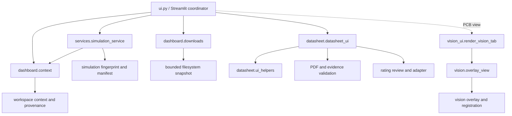

# Phase 18.2 — Module Dependencies

## Refactored boundaries

## Responsibilities

| Module | Responsibility | State/process ownership |
| --- | --- | --- |
| `circuitcare.ui` | Existing Streamlit entry, workflow coordination, compatibility exports | Existing Session State keys remain here |
| `dashboard.context` | Analysis context key, cache/result identity, measurement set identity, result reuse predicates | No Streamlit dependency |
| `dashboard.downloads` | Bounded CSV digest and immutable cached snapshot | Cache is keyed by path, digest, and context as before |
| `services.simulation_service` | ngspice CLI subprocess invocation and live output/manifest validation | Preserves `close_fds=False`, absolute CLI paths from caller, timeout, and output file contract |
| `datasheet.datasheet_ui` | PDF review and user-gated approval/application workflow | Existing datasheet Session State and approval records |
| `datasheet.ui_helpers` | Pure source/document matching and risk comparison row preparation | No Streamlit dependency |
| `vision_ui` | Image upload, board correction, CSV alignment inputs, confirmation interaction | Existing `vision_*` Session State keys |
| `vision.overlay_view` | Confirmed location mapping, risk overlay rendering, evidence details and exports | Called only after same-board and confirmation checks |

## Import direction and cycle check

The new helper and service modules do not import `circuitcare.ui`. Compatibility runs in one direction: `ui.py` imports/re-exports helper names. Datasheet helpers import only standard-library and local value data. Vision's confirmed-overlay view receives callback helpers from `vision_ui`, so it does not import its caller. The resulting refactored module graph is acyclic.

The existing graph, SPICE runner, diagnosis, reporting, workspace, and risk engines remain authoritative domain modules. The Streamlit UI consumes them; they do not depend on the new dashboard modules.
